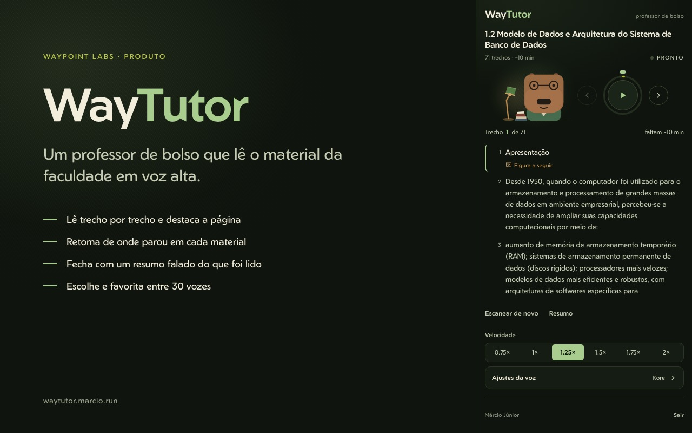
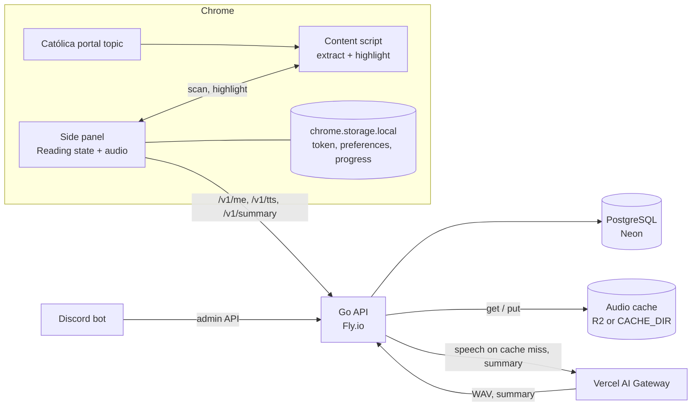

# WayTutor

A pocket professor for the reading material of a college portal. WayTutor is a
Chrome side-panel extension that reads a Brightspace topic aloud, passage by
passage, highlights the passage on the page, pauses so the listener can look at
a figure, and ends with a spoken summary grounded in the material.

[Add to Chrome][store] · [Product page][product] · [Privacy policy][privacy]

[store]: https://chromewebstore.google.com/detail/waytutor/mijecohpljijnlcagmpdgcckpadfldah
[product]: https://waypoint.marcio.run/waytutor
[privacy]: https://waytutor.marcio.run/privacidade

The published item is unlisted, so it does not appear in Chrome Web Store
search. It is built for the Católica Brightspace portal, and the extension
interface is in Portuguese; the code and this README are in English.



## What it does

- Extracts the Material from the portal topic and drops menus, figure captions,
  source credits, references and institutional boilerplate.
- Splits the Material into Passages (a paragraph, a whole list, a table row),
  synthesises each Passage separately, preloads the next two and highlights the
  current one in the page.
- Stays silent for a configurable pause after the Passage before a Figure, so
  the listener can look at the image.
- Saves the position per Material, so reopening the same topic resumes where it
  stopped, even after the panel was closed.
- Offers 30 Gemini voices (Kore by default), playback from 0.75x to 2x and a
  voice change that applies from the next Passage. A custom picker pins
  favorite voices above the full list.
- Generates a 2 to 4 minute spoken summary from the Material, grounded only in
  what the Material says.

## Install

Requirements: Chrome 116 or newer and a Google account that was approved.

1. Open the [Chrome Web Store listing][store] and add the extension.
2. Pin it to the toolbar and click the icon to open the side panel.
3. Sign in with Google and wait for approval. New accounts start as `pending`.
4. Open an HTML topic in the portal. The panel lists the Passages; press
   **Ouvir**.

Access is approved one account at a time; there is no open signup. Use the
Discord bot or the SQL in [Approve an account](#approve-an-account).

## Repository

| Path | Responsibility |
| --- | --- |
| `apps/extension` | WXT + React side panel, content script, storage |
| `apps/api` | Go API, migrations, quota and audio cache |
| `apps/bot` | Go Discord bot that approves accounts |
| `apps/site` | Static pages for Cloudflare Pages |
| `docs` | ADRs and the mascot specification |

## Run locally

Requirements: Docker, Node 22+, Go 1.26+ and, for anything beyond the compose
stack, a PostgreSQL database (production uses Neon).

### Full stack

```sh
cp apps/api/.env.example apps/api/.env
# fill GOOGLE_CLIENT_ID, GOOGLE_CLIENT_SECRET, OAUTH_STATE_SECRET and
# AI_GATEWAY_API_KEY
make up
make down
```

`make up` builds the api, starts PostgreSQL, runs the migrations and serves the
api on `:8080`. Compose reads `apps/api/.env` and overrides `DATABASE_URL` and
`CACHE_DIR` to the container paths.

To run only the api against the compose database:

```sh
docker compose up -d db
make migrate
make dev
```

### Extension

```sh
cd apps/extension
npm install
npm run dev
```

Load `apps/extension/.output/chrome-mv3-dev` as an unpacked extension (a
production build creates `.output/chrome-mv3`). Development falls back to
`http://localhost:8080`; set `WXT_API_URL` to point it elsewhere. `npm run
build` reads `apps/extension/.env.production`, which points at the deployed api.

### Google login

Create an OAuth **web** client in the Google Cloud console and add both redirect
URIs:

```
http://localhost:8080/auth/google/callback
https://waytutor-api.marcio.run/auth/google/callback
```

Then fill `GOOGLE_CLIENT_ID`, `GOOGLE_CLIENT_SECRET`, `OAUTH_STATE_SECRET` (16
characters or more) and `BASE_URL` in `apps/api/.env`. The extension starts the
flow with `chrome.identity.launchWebAuthFlow`; the api only accepts the
`https://*.chromiumapp.org` redirect that Chrome creates.

### Approve an account

The api creates new accounts with `status = 'pending'`. They can complete the
Google login, but every authenticated call is rejected with
`approval_required` until the account is approved:

```sh
# local compose database
docker compose exec db psql -U waytutor -d waytutor \
  -c "UPDATE accounts SET status = 'active', updated_at = now() WHERE email = 'someone@example.com'"
```

For a remote database, run the same statement with `psql "$DATABASE_URL"`. The
[bot](#bot) can also approve, pause and revoke accounts.

## How it works



The content script runs in the portal frames, extracts the Material and
highlights the current Passage. The side panel owns the Reading: it keeps the
Passage index, calls `chrome.tabs.sendMessage`, plays the audio and holds a
three-Passage buffer. Closing the panel ends the Reading, because the panel is
the player; the position stays saved.

Each Passage is synthesised on its own. The player applies speed with
`playbackRate`, and a change of voice applies from the next Passage, not to
audio already loaded. The api reserves quota before calling the provider and
refunds it when the provider fails. Defaults are 500,000 characters per account
per month, 6,000,000 globally, 200 summaries per account per month and 40
requests per minute; all are configurable in `apps/api/.env`.

The server does not cache summaries. The panel reuses a summary while it is
open, so opening the screen twice in the same session does not pay twice.

## API

| Method | Path | Auth |
| --- | --- | --- |
| GET | `/healthz` | none |
| GET | `/auth/google?redirect_uri=` | none |
| GET | `/auth/google/callback` | none |
| POST | `/v1/auth/exchange` | none |
| POST | `/v1/auth/logout` | bearer |
| GET | `/v1/me` | bearer |
| POST | `/v1/tts` | bearer |
| POST | `/v1/summary` | bearer |
| GET | `/admin/accounts?status=&email=` | admin |
| GET | `/admin/usage` | admin |
| POST | `/admin/accounts/{id}/status` | admin |
| DELETE | `/admin/accounts/{id}/sessions` | admin |

`GET /v1/me` returns the account, the voice catalogue and the default voice.
`POST /v1/tts` takes `{"text": "...", "voice": "Kore"}` and returns WAV bytes;
the text is limited to 8,000 characters. `POST /v1/summary` takes
`{"text": "<the whole Material>"}` and returns `{"summary": "..."}`; the text is
limited to 120,000 characters, and every call is a model call.

The admin routes exist only when `ADMIN_TOKEN` is set, and they authenticate
with `X-Admin-Token`.

The api posts every 5xx response to the Discord webhook in
`DISCORD_ALERT_WEBHOOK_URL`, the `waytutor-alerts` channel. The message carries
the route, status, duration and request id, which finds the failure in the
request log. The same route failing with the same status alerts once per 10
minutes. Leave the variable empty to turn alerts off.

The health check polls `/healthz`, the panel polls `/v1/me` and the bot polls
`/admin/accounts`. A successful call to those three is not logged. A failure is.

<details>
<summary>Error codes</summary>

Errors are `{"error":{"code":"..."}}` with an English code: `invalid_request`,
`invalid_redirect_uri`, `invalid_state`, `invalid_code`, `oauth_failed`,
`unauthenticated`, `approval_required`, `account_paused`, `empty_text`,
`text_too_long`, `unknown_voice`, `quota_exceeded`, `rate_limited`,
`provider_auth`, `provider_quota`, `provider_error`, `internal_error`.

</details>

## Audio cache

An audio object is keyed by the hash of the speech model, voice, instructions,
output format and text. A cache hit consumes no quota and returns `ETag` and
`Cache-Control: immutable`. Changing the voice, the model or the instructions
produces a new object instead of a stale hit.

Without `R2_ENDPOINT`, `R2_BUCKET`, `R2_ACCESS_KEY_ID` and
`R2_SECRET_ACCESS_KEY`, the api caches audio in `CACHE_DIR`. Production sets all
four, which makes the machine stateless. The four must be set together.

## Bot

`apps/bot` is the Discord bot that approves accounts. It talks to the admin api
with `X-Admin-Token`, so the endpoints only exist when the api was deployed with
that secret. It polls for pending accounts every `POLL_INTERVAL` and posts a
notice in `DISCORD_CHANNEL_ID`.

```sh
cd apps/bot
cp .env.example .env   # Discord app, guild, channel, admin ids and ADMIN_TOKEN
go run ./cmd/bot
```

Commands: `/tutor pending`, `/tutor approve email:...`, `/tutor pause email:...`
and `/tutor revoke email:...`. Only the ids listed in `DISCORD_ADMIN_USER_IDS`
can run them.

Deploy with `cd apps/bot && fly deploy`: app `waytutor-bot`, one always-on
machine, no HTTP service.

## Site

`apps/site` holds plain HTML served by Cloudflare Pages at
`https://waytutor.marcio.run`. There is no build step. Pages serves
`/privacidade` and `/privacy` from the `.html` files, and those are the URLs to
use in the store listing. The links inside the pages keep the `.html` extension
so a plain static server can preview them.

```sh
npx wrangler pages deploy apps/site --project-name waytutor-site
python3 -m http.server 8000 --directory apps/site   # preview, then open :8000
```

## Check

```sh
make check
```

This runs `gofmt`, `go vet` and `go test` for the api and the bot, then
`npm test` and the extension typecheck. CI builds all three apps on pushes to
`main` and on pull requests.

## Deploy

```sh
cd apps/api && fly deploy
```

The api answers on `https://waytutor-api.marcio.run`, and `waytutor.fly.dev` is
the platform origin for debugging. `fly.toml` runs `cmd/migrate` as the release
command, so migrations land before the new release serves traffic. Secrets live
in `fly secrets`, never in the image.

The extension build points at the api through `apps/extension/.env.production`.

## Known limits

- Only HTML topics with text are supported. PDF, quiz, SCORM and video are out
  of scope for this version.
- The extractor and host permissions target the Católica portal. Another portal
  needs new host permissions and a different extractor.
- Extraction depends on the portal frame markup. A portal change can break the
  selectors.
- The panel owns the Reading, so closing it stops playback. The position is
  saved and resumes on the next open.
- The interface is Portuguese only.

## Privacy

The extension stores the access token, preferences and reading progress in
`chrome.storage.local`. The material text goes to the api, which generates and
caches audio and generates summaries. There are no ads or usage analytics. The
details are in the [privacy policy][privacy] (also available in
[Portuguese](https://waytutor.marcio.run/privacidade)).
